<div align="center">

# 🎬 vid-editing · Roblox Shorts from one prompt

**One concept in. A finished, checked, vertical Roblox Short out.**

Writing, sets, R6 animation, drawn faces, camera, voices, captions, sound, mastering and verification, all in code,
driven by an agent skill.


</div>

```
/roblox-shorts In this world, you hear a ding every time someone talks about you behind your back
```

…and the agent picks the format, writes the script, builds the set in Roblox Studio, poses and shoots R6 actors
frame by frame, voices the lines through ElevenLabs, captions and mixes, and hands back `out/<slug>.mp4` with every
check on the delivered file passing. Uploading stays with the owner, every time.

## How it works

```mermaid
flowchart LR
    A[concept] --> B[format + script<br/><sub>skill/roblox-shorts</sub>]
    B --> C[direct.py<br/><sub>shots, cast, faces, camera</sub>]
    C --> D[voice<br/><sub>ElevenLabs → voice.py</sub>]
    D --> E[plan<br/><sub>every key on its word</sub>]
    E --> F[shoot<br/><sub>Roblox Studio, frame by frame</sub>]
    F --> G[cut<br/><sub>captions, overlays</sub>]
    G --> H[mix + master<br/><sub>-14 LUFS</sub>]
    H --> I[deliver + verify<br/><sub>qc · audio · sheets</sub>]
    I --> J[review<br/><sub>a fresh agent</sub>]
```



| Stage | What happens | Tool |
|---|---|---|
| **Concept** | 10 candidates, three premise tests, a score, the pick | `skill/roblox-shorts/writing/concepts.md` |
| **Script** | the format's beat table and word budget; a quotable line, a hidden detail, a loop | `skill/roblox-shorts/formats/` |
| **Direct** | sets and marks, cast looks, poses and faces keyed to words, a camera move per shot | `tools/shots.py` |
| **Voice** | takes from ElevenLabs, silences cut, sped up 1.1-1.2x, levelled; every scripted word heard | `tools/edit/voice.py` |
| **Plan** | shot lengths, word-anchored keys, captions, effects, the timeline every check reads | `tools/make.py plan` |
| **Shoot** | sets built from code in a playtest; R6 actors posed per frame; 960 x 1707 portrait frames | `tools/make.py shoot` |
| **Cut** | 1080 x 1920 master: captions in the references' house style, icons, swoop streaks | `tools/make.py cut` |
| **Mix** | voices, effects, a ducked music bed, mastered to -14 LUFS, -2.4 dBTP | `tools/make.py mix` |
| **Deliver** | H.264 + AAC, then loudness, flashes, read time, clicks, sync, sheets on the delivered file | `tools/make.py deliver` |

## What it has made

| Video | Format | Length | Notes |
|---|---|---|---|
| `videos/group-project` | rant | 26.9 s | "Nah, why does every group project have that ONE person?": three examples that escalate, a boom on every punch, "Seen.", "WE?!", the forty slides on a laptop, the same A+ for all three |
| `videos/ding` | "In this world" story | 33.6 s | 21 shots across two schools, a classroom and a cafeteria; a bell and a ding on every ding, louder as the story says louder; he hides behind a bank of lockers to listen |
| `videos/first-vs-last` | music comparison | 10.0 s | cut on the accents of a YouTube Audio Library track (measured: 120 BPM, 3-3-2); a boom on the turn a phone can hear; "Me:", the channel's narrator, wrecked on day one |
| `videos/pet-narrator` | "In this world" story | 29.9 s | M5, the one-prompt run: pets built from code, a mirror with Max's reflection in it, a cartoon on the TV, the gym dressed for the dance; a speech bubble whenever a pet speaks |
| `videos/s7-test` | pipeline test | 6.4 s | the first end-to-end file |

Each folder holds the video's `direct.py` (its whole spec, in code), `short.json`, `notes.md` (the concepts weighed,
the pick, the decisions), `review.md` (every independent review round: what it found, why, and the fix) and
`package.md` (the title, description and hashtags to paste when uploading). The files themselves are built into
`out/` and never committed.

## Quick start

**You need:** Windows with Roblox Studio, Python 3.11, FFmpeg on the PATH, and Claude Code with the ElevenLabs
connector (for voices).

```powershell
git clone https://github.com/siwqioaw/vid-editing && cd vid-editing
pip install -r requirements.txt
python tests/selftest.py                      # 131 checks against planted failures
python tools/roblox/facekit.py build build/faces/kit --install   # the 43 faces, into Studio
python tools/install_skill.py                 # the skill, for every agent on this machine
python tools/doctor.py                        # is everything ready?
```

Then open Studio on a Baseplate place (uncovered, on its own monitor: `docs/ROBLOX_CAPTURE.md`), start the bridge
(`python tools/roblox/studio_mcp.py serve`), and ask Claude Code:

```
/roblox-shorts <your concept>
```

Or run the stages by hand on an existing video:

```powershell
python videos/group-project/direct.py         # writes short.json
python tools/make.py all videos/group-project # plan, shoot, cut, mix, deliver (after the voice stage)
```

## The library

| | |
|---|---|
| **Sets** | classroom · hallway · bedroom · living room · street (day / night) · gym (with a school-dance dressing) · cafeteria · cyclorama, built from code with marks and camera marks, several per video; props from blocky pets to a bank of lockers to hide behind, a laptop with the work on its screen, a mirror whose reflection is a second actor, a cartoon on the TV (`docs/SETS.md`) |
| **Cast** | 17 looks from free Roblox catalog items and plain colours, checked on R6 and against the references' recurring characters, including our own recurring narrator (`tools/roblox/cast.json`) |
| **Faces** | 43 expressions in one hand-tuned line style, swapped on the word (`docs/FACES.md`) |
| **Poses** | 16 snappy R6 poses, sitting included, that snap in 5 frames and drift; poses combine as data; planted leans; a heel-to-toe walk that ends turned to its mark (`tools/roblox/pose.py`) |
| **Camera** | push, pull, swoop, dutch, low, top-down, over the shoulder with depth of field, two-shot, aimed where each pose puts the face (`tools/shots.py`) |
| **Before the shoot** | the plan warns about anyone never in frame, a face (or a story's hair) under the captions, a face cut by the frame's edge at a shot's start, middle or end, or under the Shorts UI, a gesture cut off, a jump cut, an icon whose subject is hidden behind someone, actors inside each other or inside the furniture, and a camera inside a prop or outside the room; `plan --check` tries a restage without writing anything (`tools/make.py plan`) |
| **Voices** | a cast picked by measuring 14 auditions against the references: narrator, girl, deep punch, storyteller (`docs/VOICE.md`) |
| **Captions** | the references' three styles, matched to within 2 px on full-size frames (`docs/CAPTIONS.md`) |
| **Sound** | effects from code (a boom with 47 Hz sub and the body a phone speaker can play, whooshes, dings), music beds, ducking, mastering (`docs/AUDIO.md`) |

## Measured, not guessed

An agent can't watch or listen, so every claim is measured on the delivered file and every check is itself tested:
`tests/selftest.py` plants a failure for each check (flashes, short captions, clicks at cuts, undeclared sound across
a cut, a missing word, a long pause, a peak over the ceiling, a face off the head...) and fails if any check misses it.
Every round of work gets an independent reviewer, and every new kind of failure joins `docs/VERIFY.md`. The first
review of each of the first four videos found problems every automated check had passed (half the bells off screen,
cuts off the beat, an elbow through an arm, a camera inside a parked car); each became a check, a selftest case or a
checklist line (`videos/*/review.md`).

| Part | Tested |
|---|---|
| The checks (`tools/verify/`) | `tests/selftest.py`: 131 of 131 |
| Portrait capture, actors, faces, posing, camera | spikes S1-S4 in Studio (`docs/ROBLOX_CAPTURE.md`) |
| Voice | spike S5: 14 auditions measured; an independent review's fixes in (`docs/VOICE.md`) |
| Captions | spike S6: baselines within 2 px of the references; their pace measured from the picture (a new caption every 0.55-0.73 s, the fastest 5% at 30-45 characters a second) and the read-time check set from it (`docs/CAPTIONS.md`) |
| The pipeline | spike S7: `videos/s7-test`, every check passing; then M2-M5, each with an independent review (`docs/MAKING.md`) |

## Documents

| Read | For |
|---|---|
| [`skill/roblox-shorts/SKILL.md`](skill/roblox-shorts/SKILL.md) | The skill: the run, the rules, where everything is |
| [`docs/MAKING.md`](docs/MAKING.md) | The pipeline and the spec format |
| [`docs/ROBLOX_SHORTS_PLAN.md`](docs/ROBLOX_SHORTS_PLAN.md) | The plan, the spikes and milestones, the owner's decisions |
| [`refs/r6rants/SYNTHESIS.md`](refs/r6rants/SYNTHESIS.md) | What 16 Shorts over 1M views have in common, measured |
| [`docs/VERIFY.md`](docs/VERIFY.md) | The timeline file, every check, the reviewer's checklist |
| [`docs/ROBLOX_CAPTURE.md`](docs/ROBLOX_CAPTURE.md) | Capturing posed frames from Studio through its MCP server |
| [`docs/VOICE.md`](docs/VOICE.md), [`docs/CAPTIONS.md`](docs/CAPTIONS.md), [`docs/SETS.md`](docs/SETS.md), [`docs/FACES.md`](docs/FACES.md) | Voices, captions, sets, faces |
| [`docs/AUDIO.md`](docs/AUDIO.md), [`docs/PICTURE.md`](docs/PICTURE.md), [`docs/LESSONS.md`](docs/LESSONS.md) | Sound and picture rules; what the first project (a horror trailer) taught |

## Layout

```
skill/roblox-shorts/   the agent skill: SKILL.md, formats/, writing/, library, building, assets, checklist
tools/make.py          the pipeline         tools/shots.py      shot helpers       tools/doctor.py   readiness
tools/roblox/          Studio bridge, capture harness, sets (kit.py), cast, faces (facekit.py), poses, camera
tools/edit/            voice, captions, effects, cue sheet, master, render, deliver, type, fx
tools/verify/          qc, audio, speech, caption_pace, sheets, transcribe, analyze, study, timeline
videos/<slug>/         one folder per video: direct.py, short.json, notes.md   videos/LEDGER.md: the variety ledger
refs/r6rants/          the reference study: notes, transcripts, measurements, listener pass, synthesis
assets/                fonts (Montserrat, OFL) and emoji (Noto), with their licences
build/, out/           generated: never committed
```

## House rules

Teen audience, not made for kids; roast types, never people; spooky but safe. Everything original: never the
references' footage, music, characters or jokes. Every asset licensed and listed in [`ATTRIBUTION.md`](ATTRIBUTION.md).
No keys or tokens ever seen, typed, logged or committed. Publishing is always the owner's call. The full rules are in
[`CLAUDE.md`](CLAUDE.md).

<sub>Not affiliated with Roblox. Roblox is a trademark of Roblox Corporation.</sub>
